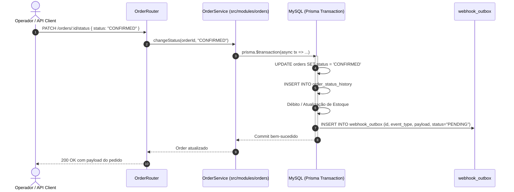
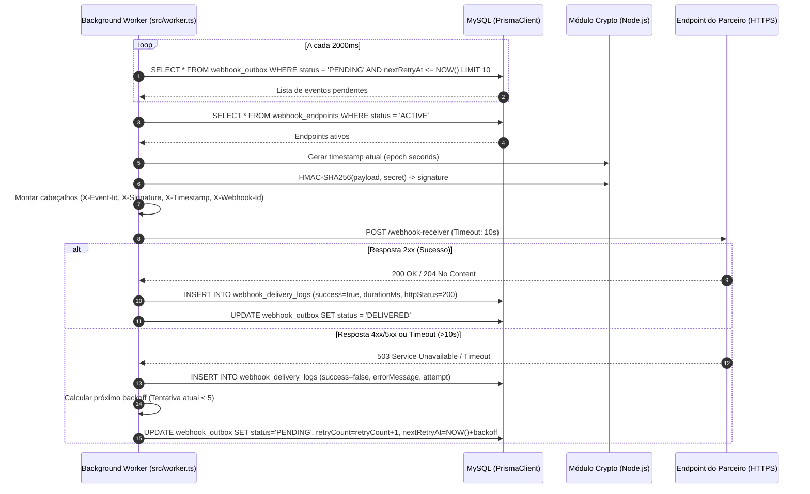
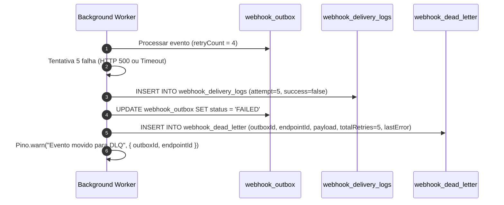
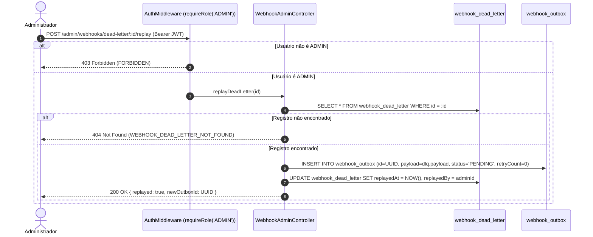

# Feature Design Document (FDD): Sistema de Notificação Outbound por Webhooks

| Metadado | Detalhe |
| :--- | :--- |
| **Documento** | Feature Design Document (FDD) |
| **Projeto** | Notificação de Transição de Status de Pedidos via Webhooks Outbound |
| **Status** | Aprovado para Implementação |
| **Versão** | 1.0.0 |
| **Módulo** | `src/modules/webhooks/` |
| **Data** | 2026-11-24 |
| **Autores** | Equipe de Engenharia (Larissa, Bruno, Diego, Sofia, Marcos) |
| **Referências** | RFC-001, ADR-001 a ADR-006, TRANSCRICAO.md |

---

## 1. Contexto & Motivação Técnica

O sistema de gerenciamento de pedidos atual processa alterações de estado de pedidos de forma transacional no banco de dados MySQL via Prisma ORM (`src/modules/orders/order.service.ts`). Clientes corporativos B2B (como Atlas E-commerce, MaxDistribuição e Nova Cargo Transportes) necessitam sincronizar em tempo real seus sistemas locais de fulfillment, WMS e ERP a cada atualização de pedido (como `CONFIRMED`, `DISPATCHED`, `DELIVERED`, `CANCELLED`).

Atualmente, esses parceiros realizam polling constante através do endpoint `GET /orders`, gerando alto overhead desnecessário de I/O de rede e sobrecarga no banco de dados. Para resolver essa deficiência estrutural, este FDD define a arquitetura técnica, modelo de dados, contratos de API, protocolo de envio seguro e estratégias de resiliência para notificações outbound baseadas no padrão **Transactional Outbox**.

---

## 2. Objetivos Técnicos

1. **Garantir Atomicidade Transacional:** O evento de mudança de status (`order.status_changed`) deve ser persistido na mesma transação atômica do MySQL que altera o status do pedido, eliminando inconsistências e estados parciais.
2. **Garantia de Entrega At-Least-Once:** Nenhuma notificação de pedido confirmado/despachado/entregue deve ser perdida; se o parceiro falhar, o sistema deve tentar novamente com backoff exponencial.
3. **Isolamento de Processamento:** O processamento e despacho HTTP das notificações devem ser executados em processo de background worker dedicado (`src/worker.ts`), desacoplado da API REST principal.
4. **Segurança Criptográfica e Integridade:** Todas as requisições HTTP outbound devem ser assinadas via HMAC-SHA256, exigir conexões HTTPS e contar com controle de payload máximo de 64 KB.
5. **Deduplicação Determinística no Cliente:** Disponibilizar cabeçalho único `X-Event-Id` gerado pelo emissor para possibilitar idempotência nos sistemas consumidores.
6. **Operabilidade e Recuperabilidade:** Fornecer tabela de Dead Letter Queue (DLQ) e endpoint administrativo para consulta e replay manual com auditoria.

---

## 3. Escopo Técnico e Exclusões

### 3.1. Em Escopo (MVP)
- Tabela `webhook_outbox` persistida no MySQL gerenciada via Prisma ORM.
- Hook transacional acoplado ao método `OrderService.changeStatus` (`src/modules/orders/order.service.ts`).
- Processo de background worker separado (`src/worker.ts`), rodando polling a cada 2 segundos.
- Assinatura criptográfica HMAC-SHA256 com cabeçalho `X-Signature` e rotação de secret com 24 horas de suporte simultâneo (carência).
- Política de retry com 5 tentativas e backoff exponencial progressivo (1 min, 5 min, 30 min, 2 h, 12 h).
- Tabela `webhook_dead_letter` (DLQ) para eventos que esgotarem as 5 tentativas.
- API REST para cadastro, listagem, remoção e consulta de entregas de endpoints de webhook.
- Endpoint de replay da DLQ restrito a usuários com perfil `ADMIN`.
- Estruturação de logs padronizados via Pino com mascaramento de dados sensíveis.

### 3.2. Fora de Escopo (Postecipado)
- **Webhooks Inbound:** Recepção de webhooks de provedores terceiros (como gateways de pagamento).
- **Interface Visual (Dashboard):** Tela gráfica no frontend para gerenciamento de URLs e logs.
- **Transbordo para E-mail:** Fallback para envio de notificações por e-mail quando o webhook falhar.
- **Expurgo Automatizado:** Rotina de arquivamento ou limpeza de registros de outbox e logs com mais de 30 dias.
- **Broker Externo (Kafka/RabbitMQ/Redis):** O MVP operará 100% sobre o MySQL existente.

---

## 4. Integração com o Sistema Existente

A implementação da funcionalidade de Webhooks foi projetada para se acoplar organicamente à arquitetura existente do repositório, sem quebrar nenhuma interface pública ou comportamento consolidado.

### 4.1. Mapeamento de Arquivos e Componentes do Repositório

| Componente Existente | Caminho no Repositório | Ponto de Acoplamento / Integração |
| :--- | :--- | :--- |
| **Serviço de Pedidos** | `src/modules/orders/order.service.ts` | No método `changeStatus(id, newStatus)` (linhas 126-179), a transação `prisma.$transaction(async (tx) => ...)` receberá a chamada de persistência de evento na tabela `webhook_outbox` usando a instância transacional `tx`. O evento só existirá se a transação do pedido commitar com sucesso. |
| **Esquema de Dados** | `prisma/schema.prisma` | Inclusão dos modelos relacionais `WebhookEndpoint`, `WebhookOutbox`, `WebhookDeliveryLog` e `WebhookDeadLetter`, referenciando seletivamente `Order` e `Customer`. |
| **Tratamento de Erros** | `src/shared/errors/app-error.ts` | Extensão da classe `AppError` com novos códigos de erro padronizados (`WEBHOOK_*`), garantindo formatação consistente de payload JSON e status HTTP nas rotas da API. |
| **Middleware de Autenticação** | `src/middlewares/auth.middleware.ts` | Reuso dos middlewares `authenticate` e `requireRole('ADMIN')` para proteger endpoints de gerenciamento de webhooks e garantir que o replay de DLQ seja exclusivo para administradores. |
| **Middleware Global de Erros** | `src/middlewares/error.middleware.ts` | Captura global automática de exceções `AppError` e `PrismaClientKnownRequestError` disparadas pelo novo módulo `src/modules/webhooks/`. |
| **Roteador Principal** | `src/routes/index.ts` | Registro do prefixo `/webhooks` e `/admin/webhooks` conectando os novos controllers às rotas express existentes. |
| **Logger Centralizado** | `src/shared/logger/index.ts` | Utilização da instância global de Pino logger, herdando a configuração de redaction para mascarar segredos HMAC e tokens (`headers['x-signature']`, `secret`). |

### 4.2. Acoplamento Transacional no `OrderService`

O trecho de código abaixo ilustra a extensão arquitetural no método `changeStatus` de `src/modules/orders/order.service.ts`:

```typescript
// src/modules/orders/order.service.ts
await this.prisma.$transaction(async (tx) => {
  // 1. Atualização do pedido e criação do histórico de status existente
  const updatedOrder = await tx.order.update({
    where: { id },
    data: { status: newStatus }
  });

  await tx.orderStatusHistory.create({
    data: {
      orderId: id,
      fromStatus: currentOrder.status,
      toStatus: newStatus
    }
  });

  // 2. Operações de estoque existentes (débito/estorno)...

  // 3. NOVO: Publicação atômica do evento de outbox para Webhooks
  await tx.webhookOutbox.create({
    data: {
      id: crypto.randomUUID(),
      eventType: 'order.status_changed',
      orderId: id,
      payload: {
        event: 'order.status_changed',
        timestamp: new Date().toISOString(),
        data: {
          order_id: updatedOrder.id,
          customer_id: updatedOrder.customerId,
          from_status: currentOrder.status,
          to_status: newStatus,
          total: Number(updatedOrder.total),
          items_count: updatedOrder.itemsCount
        }
      },
      status: 'PENDING',
      retryCount: 0,
      nextRetryAt: new Date()
    }
  });
});
```

---

## 5. Modelo de Dados Relacional (Prisma)

Os novos modelos que compõem o módulo de Webhooks no arquivo `prisma/schema.prisma`:

```prisma
enum WebhookStatus {
  ACTIVE
  INACTIVE
}

enum OutboxStatus {
  PENDING
  PROCESSING
  DELIVERED
  FAILED
}

model WebhookEndpoint {
  id               String               @id @default(uuid())
  url              String
  description      String?
  status           WebhookStatus        @default(ACTIVE)
  secret           String               // Segredo ativo para assinatura HMAC-SHA256
  previousSecret   String?              // Segredo anterior durante rotação
  secretExpiresAt  DateTime?            // Expiração do previousSecret (janela de 24h)
  createdAt        DateTime             @default(now()) @map("created_at")
  updatedAt        DateTime             @updatedAt @map("updated_at")
  deliveries       WebhookDeliveryLog[]

  @@map("webhook_endpoints")
}

model WebhookOutbox {
  id          String       @id @default(uuid())
  eventType   String       @map("event_type")
  orderId     String       @map("order_id")
  payload     Json
  status      OutboxStatus @default(PENDING)
  retryCount  Int          @default(0) @map("retry_count")
  nextRetryAt DateTime     @default(now()) @map("next_retry_at")
  lockedAt    DateTime?    @map("locked_at")
  createdAt   DateTime     @default(now()) @map("created_at")
  updatedAt   DateTime     @updatedAt @map("updated_at")

  @@index([status, nextRetryAt])
  @@index([orderId])
  @@map("webhook_outbox")
}

model WebhookDeliveryLog {
  id           String          @id @default(uuid())
  endpointId   String          @map("endpoint_id")
  eventId      String          @map("event_id")
  httpStatus   Int?            @map("http_status")
  requestBody  Json            @map("request_body")
  responseBody String?         @db.Text @map("response_body")
  durationMs   Int             @map("duration_ms")
  success      Boolean
  errorMessage String?         @map("error_message")
  attempt      Int
  createdAt    DateTime        @default(now()) @map("created_at")

  endpoint     WebhookEndpoint @relation(fields: [endpointId], references: [id], onDelete: Cascade)

  @@index([endpointId, createdAt])
  @@index([eventId])
  @@map("webhook_delivery_logs")
}

model WebhookDeadLetter {
  id           String   @id @default(uuid())
  outboxId     String   @map("outbox_id")
  endpointId   String   @map("endpoint_id")
  eventType    String   @map("event_type")
  payload      Json
  totalRetries Int      @map("total_retries")
  lastError    String   @map("last_error")
  replayedAt   DateTime? @map("replayed_at")
  replayedBy   String?  @map("replayed_by")
  createdAt    DateTime @default(now()) @map("created_at")

  @@index([endpointId])
  @@index([createdAt])
  @@map("webhook_dead_letter")
}
```

---

## 6. Fluxos Técnicos Detalhados (Diagramas Mermaid)

### 6.1. Fluxo 1: Criação Atômica do Evento de Outbox



### 6.2. Fluxo 2: Polling e Despacho pelo Worker com Assinatura HMAC



### 6.3. Fluxo 3: Esgotamento de Retries e Envio para a Dead Letter Queue (DLQ)



### 6.4. Fluxo 4: Replay Manual de Registro na DLQ



---

## 7. Contratos Públicos da API e Outbound

### 7.1. Endpoints de Gerenciamento da API de Webhooks

#### 1. Cadastrar Endpoint de Webhook
- **Rota:** `POST /webhooks`
- **Autenticação:** `Bearer Token` (Usuário autenticado)
- **Headers:** `Content-Type: application/json`
- **Request Body:**
```json
{
  "url": "https://api.atlas-log.com.br/v1/orders/webhook",
  "description": "Endpoint WMS Atlas para status de pedidos"
}
```
- **Responses:**
  - `201 Created`:
```json
{
  "id": "e3b0c442-98fc-1c14-9afbf4c8996fb924",
  "url": "https://api.atlas-log.com.br/v1/orders/webhook",
  "description": "Endpoint WMS Atlas para status de pedidos",
  "status": "ACTIVE",
  "secret": "whsec_7b8a3f9e2d1c4b5a6f7e8d9c0b1a2e3f4a5b6c7d8e9f0a1b2c3d4e5f6a7b8c9d",
  "createdAt": "2026-11-24T10:00:00.000Z"
}
```
  - `400 Bad Request`:
```json
{
  "status": "error",
  "code": "WEBHOOK_INVALID_URL",
  "message": "A URL do webhook deve iniciar com HTTPS obrigatório e ser válida."
}
```

#### 2. Listar Endpoints Cadastrados
- **Rota:** `GET /webhooks`
- **Autenticação:** `Bearer Token`
- **Responses:**
  - `200 OK`:
```json
{
  "data": [
    {
      "id": "e3b0c442-98fc-1c14-9afbf4c8996fb924",
      "url": "https://api.atlas-log.com.br/v1/orders/webhook",
      "description": "Endpoint WMS Atlas",
      "status": "ACTIVE",
      "createdAt": "2026-11-24T10:00:00.000Z"
    }
  ]
}
```

#### 3. Remover / Desativar Endpoint
- **Rota:** `DELETE /webhooks/:id`
- **Autenticação:** `Bearer Token`
- **Responses:**
  - `204 No Content`
  - `404 Not Found`:
```json
{
  "status": "error",
  "code": "WEBHOOK_NOT_FOUND",
  "message": "Webhook endpoint não localizado."
}
```

#### 4. Consultar Histórico de Entregas
- **Rota:** `GET /webhooks/:id/deliveries`
- **Autenticação:** `Bearer Token`
- **Query Params:** `page=1&limit=20`
- **Responses:**
  - `200 OK`:
```json
{
  "data": [
    {
      "id": "f1a2b3c4-d5e6-7f8a-9b0c-1d2e3f4a5b6c",
      "eventId": "a1b2c3d4-e5f6-7a8b-9c0d-1e2f3a4b5c6d",
      "httpStatus": 200,
      "durationMs": 142,
      "success": true,
      "attempt": 1,
      "createdAt": "2026-11-24T10:15:02.120Z"
    }
  ],
  "meta": {
    "total": 1,
    "page": 1,
    "limit": 20
  }
}
```

#### 5. Rotação de Segredo com Período de Carência (24 Horas)
- **Rota:** `POST /webhooks/:id/rotate-secret`
- **Autenticação:** `Bearer Token`
- **Responses:**
  - `200 OK`:
```json
{
  "id": "e3b0c442-98fc-1c14-9afbf4c8996fb924",
  "newSecret": "whsec_99aa88bb77cc66dd55ee44ff33aa22bb11cc00dd",
  "previousSecretExpiresAt": "2026-11-25T10:00:00.000Z",
  "message": "Segredo rotacionado com sucesso. O segredo anterior permanecerá válido por 24 horas."
}
```

#### 6. Replay Manual de Evento da Dead Letter Queue (Exclusivo ADMIN)
- **Rota:** `POST /admin/webhooks/dead-letter/:id/replay`
- **Autenticação:** `Bearer Token` (Requer role `ADMIN`)
- **Responses:**
  - `200 OK`:
```json
{
  "replayed": true,
  "deadLetterId": "dlq-998877",
  "newOutboxId": "8c9d0e1f-2a3b-4c5d-6e7f-8a9b0c1d2e3f",
  "message": "Evento reenfileirado no webhook_outbox para novo ciclo de envio."
}
```
  - `403 Forbidden`:
```json
{
  "status": "error",
  "code": "WEBHOOK_UNAUTHORIZED_REPLAY",
  "message": "Apenas administradores podem executar o replay de eventos da DLQ."
}
```
  - `404 Not Found`:
```json
{
  "status": "error",
  "code": "WEBHOOK_DEAD_LETTER_NOT_FOUND",
  "message": "Registro de Dead Letter não encontrado."
}
```

---

### 7.2. Contrato Outbound (Notificação Enviada pelo Worker)

#### Cabeçalhos HTTP Outbound Obrigatórios
- `Content-Type: application/json`
- `User-Agent: FullCycle-WebhookWorker/1.0`
- `X-Webhook-Id: <UUID do Endpoint cadastrado>`
- `X-Event-Id: <UUID único do evento - chave para deduplicação>`
- `X-Timestamp: <Timestamp UNIX epoch em segundos - ex: 1732442400>`
- `X-Signature: sha256=<Assinatura HMAC-SHA256 hex>`

#### Formato do Payload Outbound (`order.status_changed`)
```json
{
  "event": "order.status_changed",
  "timestamp": "2026-11-24T10:15:00.000Z",
  "data": {
    "order_id": "ord_887766554433",
    "customer_id": "cust_11223344",
    "from_status": "PENDING",
    "to_status": "CONFIRMED",
    "total": 1450.80,
    "items_count": 3
  }
}
```

#### Cálculo e Validação da Assinatura HMAC-SHA256
A assinatura é calculada sobre a string resultante da concatenação do timestamp com o corpo da mensagem:
$$\text{SignaturePayload} = \text{X-Timestamp} + \text{"."} + \text{RawJSONBody}$$
$$\text{X-Signature} = \text{"sha256="} + \text{HMAC-SHA256}(\text{Secret}, \text{SignaturePayload})$$

---

## 8. Matriz de Erros Técnicos (`WEBHOOK_*`)

Integrada ao padrão de erros do projeto herdando de `AppError` (`src/shared/errors/app-error.ts`):

| Código de Erro | HTTP Status | Causa Raiz | Ação Recomendada / Tratamento |
| :--- | :---: | :--- | :--- |
| `WEBHOOK_NOT_FOUND` | 404 | Identificador de webhook não existe no banco de dados. | Verificar o ID fornecido na requisição. |
| `WEBHOOK_INVALID_URL` | 400 | A URL informada não usa protocolo HTTPS ou possui formato RFC inválido. | Exigir HTTPS estrito com validação de hostname. |
| `WEBHOOK_SECRET_REQUIRED` | 400 | Falha na geração ou validação do segredo do webhook. | Regenerar segredo criptográfico seguro. |
| `WEBHOOK_PAYLOAD_TOO_LARGE` | 413 | O payload a ser despachado excede o limite arquitetural de 64 KB. | Truncar ou sumarizar atributos do pedido. |
| `WEBHOOK_DELIVERY_FAILED` | 502 | O servidor de destino respondeu com erro 4xx/5xx ou excedeu o timeout de 10s. | O worker enfileira a próxima tentativa com backoff. |
| `WEBHOOK_DEAD_LETTER_NOT_FOUND` | 404 | O identificador fornecido para replay na DLQ não foi localizado. | Confirmar ID na tabela `webhook_dead_letter`. |
| `WEBHOOK_UNAUTHORIZED_REPLAY` | 403 | Tentativa de disparar replay por usuário sem privilégio `ADMIN`. | Autenticar com credencial de administrador. |

---

## 9. Estratégias de Resiliência e Tolerância a Falhas

```
[Tentativa 1] (Falha)
      ↓ (Espera 1 min)
[Tentativa 2] (Falha)
      ↓ (Espera 5 min)
[Tentativa 3] (Falha)
      ↓ (Espera 30 min)
[Tentativa 4] (Falha)
      ↓ (Espera 2 horas)
[Tentativa 5] (Falha)
      ↓ (Espera 12 horas)
[Esgotamento dos Retries (~15 horas no total)]
      ↓
[Mover para webhook_dead_letter (DLQ)]
      ↓
[Replay Manual via POST /admin/webhooks/dead-letter/:id/replay]
```

1. **Timeout Restritivo de Rede:** Cada requisição outbound tem timeout rígido configurado em **10 segundos** (via `AbortController` nativo do Node.js).
2. **Backoff Progressivo com 5 Tentativas:** A janela total de tentativas cobre aproximadamente 15 horas, mitigando interrupções temporárias nos clientes sem saturar recursos.
3. **Persistência em DLQ:** Eventos que falharem após 5 tentativas são movidos para a tabela `webhook_dead_letter` com o último erro registrado.
4. **Proteção contra Duplicação (Idempotência At-Least-Once):**
   - O worker garante at-least-once.
   - O cliente deve armazenar o `X-Event-Id` recebido e descartar processamentos repetidos caso a rede oscile durante o envio da confirmação 200 OK.

---

## 10. Observabilidade, Logging e Métricas

### 10.1. Padrão de Logs Estruturados (Pino)
Utiliza o logger global configurado em `src/shared/logger/index.ts`. Todos os eventos de despacho de webhook registram logs em formato JSON:

```json
{
  "level": "info",
  "time": 1732442405000,
  "pid": 4821,
  "hostname": "order-worker-01",
  "module": "webhook-worker",
  "event_id": "a1b2c3d4-e5f6-7a8b-9c0d-1e2f3a4b5c6d",
  "webhook_id": "e3b0c442-98fc-1c14-9afbf4c8996fb924",
  "order_id": "ord_887766554433",
  "attempt": 1,
  "duration_ms": 142,
  "http_status": 200,
  "msg": "Webhook delivery succeeded"
}
```

### 10.2. Redaction de Dados Sensíveis
O arquivo de configuração do logger mascara automaticamente:
- Campo `secret` e `previousSecret` do modelo de endpoints.
- Cabeçalho `X-Signature` e tokens contidos em requisições de entrega.

### 10.3. Métricas Operacionais Recomendadas
- `webhooks_dispatched_total`: Contador de disparos agrupado por `status` (success/failure).
- `webhooks_dispatch_duration_ms`: Histograma da latência das requisições outbound.
- `webhooks_outbox_queue_size`: Gauge de registros pendentes no `webhook_outbox`.
- `webhooks_dlq_count`: Contador de itens movidos para a Dead Letter Queue.

---

## 11. Critérios de Aceitação Técnica

1. **Atomicidade:** Se a transação no método `changeStatus` de `src/modules/orders/order.service.ts` falhar, nenhum registro deve ser inserido em `webhook_outbox`.
2. **Desacoplamento:** O tempo de resposta da rota `PATCH /orders/:id/status` não pode ser impactado pela latência das requisições HTTP dos clientes externos de webhook.
3. **Assinatura HMAC Válida:** O cabeçalho `X-Signature` deve corresponder exatamente ao HMAC-SHA256 do corpo serializado utilizando o segredo ativo do endpoint.
4. **Isolamento de Erros:** Erros HTTP 500 no endpoint do cliente não devem travar o loop de polling do worker.
5. **Replay DLQ Restrito:** Chamadas ao endpoint `/admin/webhooks/dead-letter/:id/replay` sem token de usuário com perfil `ADMIN` devem receber HTTP 403 Forbidden.
