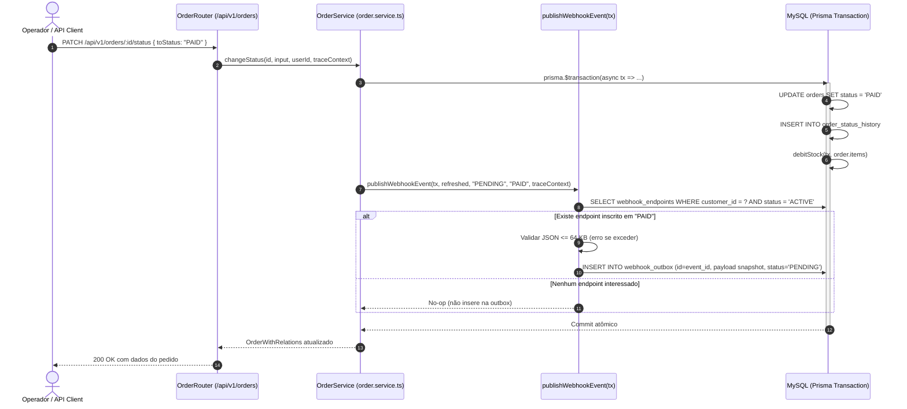
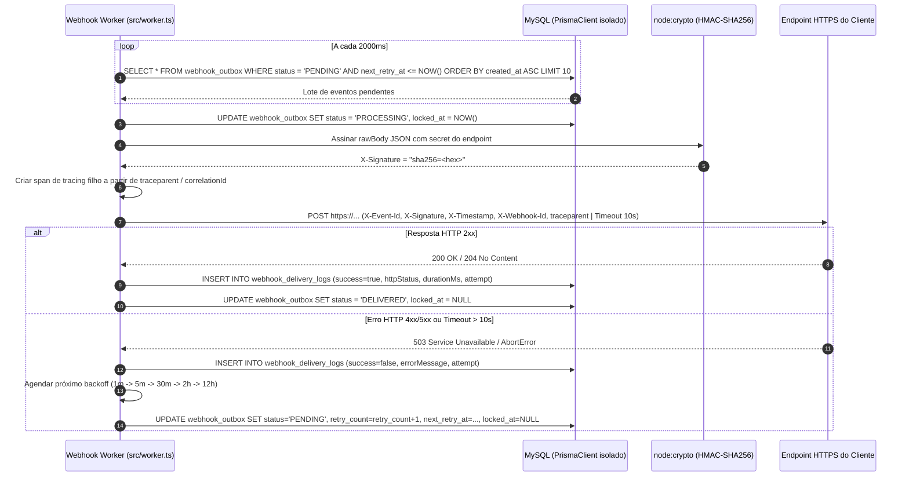
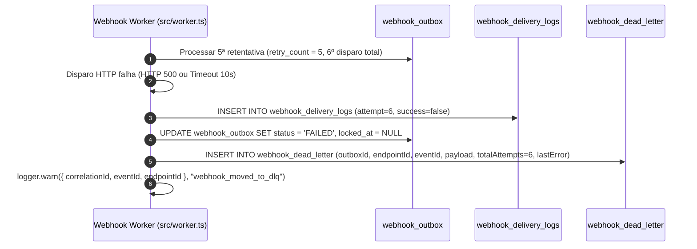
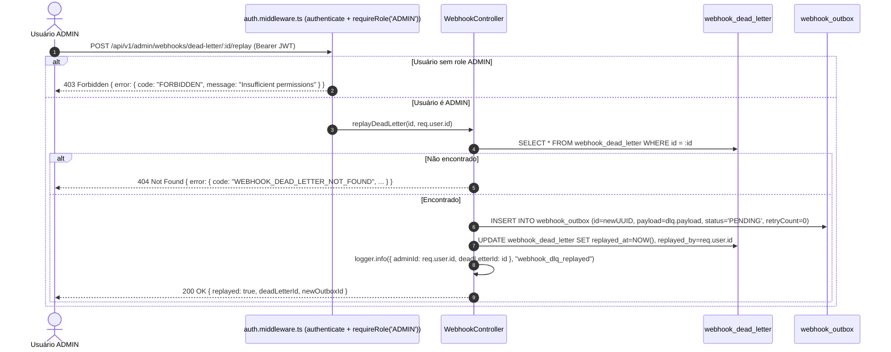

# Feature Design Document (FDD): Sistema de Notificação Outbound por Webhooks

| Metadado | Detalhe |
| :--- | :--- |
| **Documento** | Feature Design Document (FDD) |
| **Projeto** | Notificação de Transição de Status de Pedidos via Webhooks Outbound |
| **Status** | Aprovado para Implementação |
| **Versão** | 1.1.0 |
| **Módulo** | `src/modules/webhooks/` e `src/worker.ts` |
| **Data** | 2026-11-25 |
| **Autores** | Equipe de Engenharia (Larissa, Bruno, Diego, Sofia, Marcos) |
| **Referências** | RFC-001, ADR-001 a ADR-006, `TRANSCRICAO.md` |

---

## 1. Contexto e Motivação Técnica

O Order Management System (OMS) processa transições de estado de pedidos de forma transacional no banco de dados MySQL via Prisma ORM (`src/modules/orders/order.service.ts`), obedecendo à máquina de estados definida em `src/modules/orders/order.status.ts` e ao enum `OrderStatus` em `prisma/schema.prisma` (`PENDING`, `PAID`, `PROCESSING`, `SHIPPED`, `DELIVERED`, `CANCELLED`). Clientes B2B estratégicos — **Atlas Comercial**, **MaxDistribuição** e **Nova Cargo** — precisam sincronizar seus sistemas de ERP, fulfillment e logística sempre que o status de um pedido muda, com delay aceitável inferior a **10 segundos** (`[09:00]–[09:02] Marcos`).

Atualmente, esses parceiros consultam periodicamente o endpoint `GET /api/v1/orders` (polling), tornando a integração lenta e custosa para ambos os lados (`[09:00] Marcos`). Como a aplicação não possui eventos externos, filas ou webhooks, este FDD especifica em nível acionável de implementação a arquitetura **Transactional Outbox**, o worker separado em `src/worker.ts`, o protocolo de segurança criptográfica HMAC-SHA256, os contratos REST `/api/v1`, a estratégia de observabilidade (logs, métricas e tracing), dependências técnicas e riscos de implementação.

---

## 2. Objetivos Técnicos

1. **Atomicidade Transacional Estrita:** Persistir o evento `order.status_changed` na tabela `webhook_outbox` dentro da mesma transação SQL (`tx`) que atualiza `orders`, grava `order_status_history` e ajusta `stockQuantity` em `products` (`OrderService.changeStatus`), eliminando inconsistências entre estado do pedido e emissão de eventos (`[09:04] Bruno`, `[09:06] Diego`).
2. **Garantia de Entrega At-Least-Once:** Assegurar que nenhum evento comitado seja perdido, utilizando envio assíncrono com retentativas exponenciais e cabeçalho `X-Event-Id` imutável para deduplicação no consumidor (`[09:24]–[09:25] Diego`).
3. **Desacoplamento por Processo Worker Dedicado:** Executar o polling a cada **2 segundos** (2.000 ms) e os disparos HTTP em processo Node.js isolado (`src/worker.ts`), preservando a latência das rotas HTTP principais (`[09:09]–[09:11] Diego, Larissa`).
4. **Segurança Criptográfica e Validação Estrita:** Assinar o corpo JSON via **HMAC-SHA256** (`X-Signature`), manter chave secreta única por endpoint com rotação e janela de carência (*grace period*) de **24 horas**, exigir protocolo **HTTPS** e rejeitar payloads acima de **64 KB** com erro explícito (sem truncar) (`[09:20]–[09:24] Sofia, Diego`).
5. **Recuperabilidade e Governança:** Isolar eventos esgotados após **5 retentativas** na tabela `webhook_dead_letter` (DLQ) e prover endpoint administrativo autenticado com papel `ADMIN` para replay manual auditado (`[09:18] Diego`, `[09:35]–[09:36] Sofia, Larissa`).
6. **Observabilidade Unificada (Logs, Métricas e Tracing):** Reaproveitar o logger JSON Pino (`src/shared/logger/index.ts`), adicionar métricas operacionais e propagar contexto de rastreamento distribuído (`X-Request-Id` / `correlation_id` / `traceparent` W3C) da API HTTP até o worker e o endpoint do parceiro.

---

## 3. Escopo Técnico e Exclusões

### 3.1. Em Escopo (MVP)
- Novo módulo modular `src/modules/webhooks/` seguindo os padrões do projeto (`controller`, `service`, `repository`, `routes`, `schemas`, `publisher`, `processor`).
- Modelos Prisma no `prisma/schema.prisma`: `WebhookEndpoint`, `WebhookOutbox`, `WebhookDeliveryLog` e `WebhookDeadLetter` (todos com chaves UUID `@db.Char(36)`).
- Função transacional pura `publishWebhookEvent(tx, order, fromStatus, toStatus, traceContext)` chamada em `OrderService.changeStatus` (`src/modules/orders/order.service.ts`), com filtragem prévia pelos endpoints ativos do `customerId` inscritos no status de destino (`[09:34] Bruno`).
- Novo entrypoint `src/worker.ts` + script `"worker"` em `package.json`, rodando polling em loop a cada 2.000 ms.
- Endpoints REST sob `/api/v1/webhooks`: cadastro (`POST`), listagem por cliente (`GET`), edição (`PATCH`), remoção (`DELETE`), rotação de secret (`POST /:id/rotate-secret`) e histórico de entregas (`GET /:id/deliveries`).
- Endpoint administrativo `POST /api/v1/admin/webhooks/dead-letter/:id/replay` protegido por `requireRole('ADMIN')`.
- Assinatura HMAC-SHA256, headers `X-Event-Id`, `X-Signature`, `X-Timestamp`, `X-Webhook-Id` e `traceparent`, timeout de 10 segundos e política de 5 retentativas (1m, 5m, 30m, 2h, 12h).

### 3.2. Fora de Escopo (Postecipado ou em Aberto)
- **Webhooks Inbound:** Recepção de webhooks enviados por sistemas externos à API OMS (`[09:02] Marcos`, `[09:03] Sofia`).
- **Interface Visual (Dashboard):** Tela gráfica no frontend para cadastro ou inspeção de entregas (`[09:40] Larissa`).
- **Fallback por E-mail:** Envio de e-mail para parceiros em caso de falhas consecutivas — adiado para fase futura (`[09:37] Larissa`).
- **Expurgo Automático de 30 Dias:** Rotina de arquivamento/remoção de eventos `DELIVERED` após 30 dias (`[09:08] Diego`).
- **Rate Limiting Outbound por Cliente:** Controle de vazão de saída em rajadas — registrado para observação e decisão posterior em produção (`[09:38]–[09:39] Diego, Larissa`).
- **Broker Externo (Redis Streams / RabbitMQ / Kafka):** Descartado por overengineering no MVP (`[09:07] Larissa, Diego`).
- **Ordering Global Multi-Worker:** Ordenação garantida apenas por `order_id` em execução *single-worker* (`[09:12]–[09:13] Diego, Larissa`).

---

## 4. Integração com o Sistema Existente

A feature acopla-se organicamente à arquitetura existente em `src/`, reaproveitando utilitários, validações e middlewares sem quebrar nenhum módulo atual (`auth`, `users`, `customers`, `products`, `orders`).

### 4.1. Mapeamento de Arquivos Reais e Pontos de Integração

| Componente Existente | Caminho Real no Repositório | Como o Módulo de Webhooks se Integra |
| :--- | :--- | :--- |
| **Serviço de Pedidos** | `src/modules/orders/order.service.ts` | No método `changeStatus(id, input, userId)` (linhas 126–179), dentro de `this.prisma.$transaction(async (tx) => ...)`, logo após gravar `orderStatusHistory` e obter `refreshed`, invocar `await publishWebhookEvent(tx, refreshed!, from, to, traceContext)`. Se a inserção na outbox falhar (ex.: payload > 64 KB), toda a transação sofre rollback. |
| **Máquina de Estados** | `src/modules/orders/order.status.ts` | Os valores válidos do filtro de assinatura (`events`) no `WebhookEndpoint` são derivados diretamente do enum `OrderStatus` (`PENDING`, `PAID`, `PROCESSING`, `SHIPPED`, `DELIVERED`, `CANCELLED`), impedindo eventos inexistentes. |
| **Esquema Prisma / MySQL** | `prisma/schema.prisma` | Adição das tabelas `webhook_endpoints`, `webhook_outbox`, `webhook_delivery_logs` e `webhook_dead_letter` mantendo `@db.Char(36)` para UUIDs e adicionando relação inversa opcional `webhookEndpoints WebhookEndpoint[]` em `Customer` (linhas 40–54). |
| **Hierarquia de Erros** | `src/shared/errors/app-error.ts` | Criação de classes de erro específicas do domínio em `src/modules/webhooks/webhook.errors.ts` estendendo `AppError(message, statusCode, errorCode, details)` com prefixo obrigatório `WEBHOOK_*`. |
| **Middleware Global de Erros** | `src/middlewares/error.middleware.ts` | Intercepta nativamente instâncias de `AppError`, `ZodError` e `PrismaClientKnownRequestError` (`P2002`, `P2025`), serializando sempre no formato padrão `{ "error": { "code", "message", "details"? } }`. |
| **Middleware de Auth / RBAC** | `src/middlewares/auth.middleware.ts` | Todas as rotas de `/api/v1/webhooks` usam `authenticate` (linhas 27–47). A rota administrativa de replay na DLQ usa `authenticate` + `requireRole('ADMIN')` (linhas 49–61), lendo `req.user.id` para registrar `replayedBy` na auditoria. |
| **Correlação HTTP (`req.id`)** | `src/middlewares/request-logger.middleware.ts` | O `req.id` (UUID de `X-Request-Id`, linhas 6–8) é capturado no `OrderController.changeStatus` e repassado como `correlationId` para `publishWebhookEvent`, conectando logs da requisição HTTP aos logs do worker. |
| **Logger Estruturado Pino** | `src/shared/logger/index.ts` | Reuso da instância `logger` (`createLogger()`). Na implementação, o array `redactPaths` existente (linhas 4–11) **deve ser estendido** para incluir `'*.secret'`, `'*.previousSecret'`, `'*.newSecret'`, `'*.headers["x-signature"]'` e `'req.headers["x-signature"]'`. |
| **Paginação Padronizada** | `src/shared/http/response.ts` | Os endpoints `GET /api/v1/webhooks` e `GET /api/v1/webhooks/:id/deliveries` reutilizam o helper `paginated(data, page, pageSize, total)` (linhas 22–24), retornando `{ data, pagination: { page, pageSize, total, totalPages } }`. |
| **Roteador Central e App** | `src/routes/index.ts` e `src/app.ts` | Registro de `buildWebhookRouter(controllers.webhooks)` em `/webhooks` e `buildWebhookAdminRouter(controllers.webhooks)` em `/admin/webhooks` dentro de `buildApiRouter` (`src/routes/index.ts`), servidos sob `/api/v1` (`src/app.ts:67`). |
| **Banco e Configuração** | `src/config/database.ts` e `src/config/env.ts` | `src/worker.ts` reutiliza `createPrismaClient()` (`src/config/database.ts:4-8`) para abrir seu próprio `PrismaClient` no processo separado, e `envSchema` (`src/config/env.ts:3-10`) recebe parâmetros opcionais do worker. |

### 4.2. Acoplamento Transacional em `OrderService.changeStatus`

Mantendo a assinatura atual ou recebendo `traceContext` opcional para não quebrar callers/testes existentes (`tests/orders.test.ts`), a extensão proposta em `src/modules/orders/order.service.ts` segue exatamente o padrão da base:

```typescript
// src/modules/orders/order.service.ts
async changeStatus(
  id: string,
  input: UpdateOrderStatusInput,
  userId: string,
  traceContext?: { correlationId?: string; traceparent?: string },
): Promise<OrderWithRelations> {
  return this.prisma.$transaction(async (tx) => {
    const order = await tx.order.findUnique({
      where: { id },
      include: { items: true },
    });
    if (!order) throw new NotFoundError('Order');

    const from = order.status;
    const to = input.toStatus;
    // ... validações canTransition(from, to), debitStock, replenishStock existentes ...

    await tx.order.update({ where: { id }, data: { status: to } });
    await tx.orderStatusHistory.create({
      data: {
        orderId: id,
        fromStatus: from,
        toStatus: to,
        changedById: userId,
        reason: input.reason ?? null,
      },
    });

    const refreshed = await tx.order.findUnique({
      where: { id },
      include: {
        items: { include: { product: { select: { id: true, sku: true, name: true } } } },
        history: { orderBy: { changedAt: 'asc' } },
        customer: { select: { id: true, name: true, email: true } },
      },
    });

    // NOVO: Função pura transacional com filtro prévio por customerId e status `to`
    await publishWebhookEvent(tx, refreshed!, from, to, traceContext);

    return refreshed!;
  });
}
```

### 4.3. Contrato Interno da Função Pura `publishWebhookEvent`

Definida em `src/modules/webhooks/webhook.publisher.ts` (`[09:41] Bruno, Diego`):
1. Consulta `tx.webhookEndpoint.findMany({ where: { customerId: order.customerId, status: 'ACTIVE' } })`.
2. Filtra em memória os endpoints cujo array `events` contém `toStatus` (ou está configurado para aquele status). Se nenhum endpoint ativo assina `toStatus`, retorna imediatamente **sem inserir** linha na outbox (`[09:34] Bruno`).
3. Para cada endpoint correspondente:
   - Gera `eventId = uuidv4()` (via pacote `uuid` já presente em `package.json`).
   - Monta o snapshot imutável do payload (`event_id`, `event_type: 'order.status_changed'`, `timestamp`, `order_id`, `order_number`, `from_status`, `to_status`, `customer_id`, `total_cents`).
   - Valida `Buffer.byteLength(JSON.stringify(payload), 'utf8') <= 65536` (64 KB). Caso exceda 64 KB, lança `WebhookPayloadTooLargeError` abortando com erro explícito (sem truncar — `[09:23] Sofia`).
   - Insere registro na tabela `webhook_outbox` com `status = 'PENDING'`, `retryCount = 0`, `nextRetryAt = new Date()`, `correlationId` e `traceparent`.

---

## 5. Modelo de Dados Relacional (Prisma)

Adições propostas em `prisma/schema.prisma` respeitando estritamente `@db.Char(36)` para UUIDs e convenção `@@map`:

```prisma
enum WebhookStatus {
  ACTIVE
  INACTIVE
}

enum OutboxStatus {
  PENDING
  PROCESSING
  DELIVERED
  FAILED
}

model WebhookEndpoint {
  id              String               @id @default(uuid()) @db.Char(36)
  customerId      String               @map("customer_id") @db.Char(36)
  url             String               @db.VarChar(500)
  description     String?              @db.VarChar(255)
  events          Json                 // Array de OrderStatus assinados, ex.: ["PAID", "SHIPPED"]
  status          WebhookStatus        @default(ACTIVE)
  secret          String               @db.VarChar(128) // Segredo ativo para HMAC-SHA256
  previousSecret  String?              @map("previous_secret") @db.VarChar(128)
  secretExpiresAt DateTime?            @map("secret_expires_at")
  createdAt       DateTime             @default(now()) @map("created_at")
  updatedAt       DateTime             @updatedAt @map("updated_at")

  customer   Customer             @relation(fields: [customerId], references: [id], onDelete: Cascade)
  outboxJobs WebhookOutbox[]
  deliveries WebhookDeliveryLog[]

  @@index([customerId, status])
  @@map("webhook_endpoints")
}

model WebhookOutbox {
  id            String       @id @default(uuid()) @db.Char(36)
  endpointId    String       @map("endpoint_id") @db.Char(36)
  orderId       String       @map("order_id") @db.Char(36)
  customerId    String       @map("customer_id") @db.Char(36)
  eventType     String       @map("event_type") @db.VarChar(100)
  payload       Json         // Snapshot imutável renderizado na transação de changeStatus
  correlationId String?      @map("correlation_id") @db.VarChar(64)
  traceparent   String?      @db.VarChar(128)
  status        OutboxStatus @default(PENDING)
  retryCount    Int          @default(0) @map("retry_count")
  nextRetryAt   DateTime     @default(now()) @map("next_retry_at")
  lockedAt      DateTime?    @map("locked_at")
  createdAt     DateTime     @default(now()) @map("created_at")
  updatedAt     DateTime     @updatedAt @map("updated_at")

  endpoint WebhookEndpoint @relation(fields: [endpointId], references: [id], onDelete: Cascade)

  @@index([status, nextRetryAt])
  @@index([status, createdAt])
  @@index([orderId])
  @@map("webhook_outbox")
}

model WebhookDeliveryLog {
  id            String   @id @default(uuid()) @db.Char(36)
  outboxId      String   @map("outbox_id") @db.Char(36)
  endpointId    String   @map("endpoint_id") @db.Char(36)
  eventId       String   @map("event_id") @db.Char(36)
  correlationId String?  @map("correlation_id") @db.VarChar(64)
  httpStatus    Int?     @map("http_status")
  requestBody   Json     @map("request_body")
  responseBody  String?  @map("response_body") @db.Text
  durationMs    Int      @map("duration_ms")
  success       Boolean
  errorMessage  String?  @map("error_message") @db.VarChar(500)
  attempt       Int
  createdAt     DateTime @default(now()) @map("created_at")

  endpoint WebhookEndpoint @relation(fields: [endpointId], references: [id], onDelete: Cascade)

  @@index([endpointId, createdAt])
  @@index([eventId])
  @@map("webhook_delivery_logs")
}

model WebhookDeadLetter {
  id            String    @id @default(uuid()) @db.Char(36)
  outboxId      String    @map("outbox_id") @db.Char(36)
  endpointId    String    @map("endpoint_id") @db.Char(36)
  eventId       String    @map("event_id") @db.Char(36)
  eventType     String    @map("event_type") @db.VarChar(100)
  payload       Json
  correlationId String?   @map("correlation_id") @db.VarChar(64)
  totalAttempts Int       @map("total_attempts")
  lastStatus    Int?      @map("last_status")
  lastError     String    @map("last_error") @db.Text
  replayedAt    DateTime? @map("replayed_at")
  replayedBy    String?   @map("replayed_by") @db.Char(36)
  createdAt     DateTime  @default(now()) @map("created_at")

  @@index([endpointId])
  @@index([createdAt])
  @@map("webhook_dead_letter")
}
```

---

## 6. Fluxos Técnicos Detalhados (Diagramas Mermaid)

### 6.1. Fluxo 1: Criação Atômica do Evento na Outbox



### 6.2. Fluxo 2: Polling (2s) e Despacho pelo Worker com Assinatura HMAC



### 6.3. Fluxo 3: Esgotamento de Retries e Envio para Dead Letter Queue (DLQ)



### 6.4. Fluxo 4: Replay Manual de Registro na DLQ (Exclusivo `ADMIN`)



---

## 7. Contratos Públicos da API e Outbound

Todas as rotas seguem o prefixo global `/api/v1` (`src/app.ts:67`), o envelope de paginação `paginated()` (`src/shared/http/response.ts:8-24`) e o formato padronizado de erros de `src/middlewares/error.middleware.ts:16-22`.

### 7.1. Endpoints HTTP da API (`/api/v1`)

#### 1. Cadastrar Endpoint de Webhook (`POST /api/v1/webhooks`)
- **Autenticação:** `Bearer Token` (`authenticate`) — qualquer role autenticada (`[09:36] Sofia, Marcos`).
- **Nota de Regra:** `customerId` é passado explicitamente no body, pois o JWT identifica o operador do sistema e não o cliente B2B (`[09:32] Larissa`). A `secret` é gerada pelo servidor e exibida **apenas na resposta de criação** (`[09:31] Marcos`).
- **Request Body:**
```json
{
  "customerId": "7c9e6679-7425-40de-944b-e07fc1f90ae7",
  "url": "https://api.atlas-comercial.com.br/v1/orders/webhook",
  "description": "Endpoint WMS Atlas Comercial",
  "events": ["PAID", "PROCESSING", "SHIPPED", "DELIVERED", "CANCELLED"]
}
```
- **Responses:**
  - `201 Created`:
```json
{
  "id": "e3b0c442-98fc-1c14-9afb-f4c8996fb924",
  "customerId": "7c9e6679-7425-40de-944b-e07fc1f90ae7",
  "url": "https://api.atlas-comercial.com.br/v1/orders/webhook",
  "description": "Endpoint WMS Atlas Comercial",
  "events": ["PAID", "PROCESSING", "SHIPPED", "DELIVERED", "CANCELLED"],
  "status": "ACTIVE",
  "secret": "whsec_7b8a3f9e2d1c4b5a6f7e8d9c0b1a2e3f4a5b6c7d8e9f0a1b2c3d4e5f6a7b8c9d",
  "createdAt": "2026-11-25T10:00:00.000Z"
}
```
  - `400 Bad Request` (`WEBHOOK_INVALID_URL` / `VALIDATION_ERROR`):
```json
{
  "error": {
    "code": "WEBHOOK_INVALID_URL",
    "message": "Webhook URL must use HTTPS and point to a valid public host"
  }
}
```

#### 2. Listar Webhooks de um Cliente (`GET /api/v1/webhooks`)
- **Autenticação:** `Bearer Token` (`authenticate`).
- **Query Params:** `customerId=<uuid>&page=1&pageSize=20` (reutilizando `page` e `pageSize` do projeto).
- **Responses:**
  - `200 OK` *(a chave `secret` nunca é retornada na listagem)*:
```json
{
  "data": [
    {
      "id": "e3b0c442-98fc-1c14-9afb-f4c8996fb924",
      "customerId": "7c9e6679-7425-40de-944b-e07fc1f90ae7",
      "url": "https://api.atlas-comercial.com.br/v1/orders/webhook",
      "description": "Endpoint WMS Atlas Comercial",
      "events": ["SHIPPED", "DELIVERED"],
      "status": "ACTIVE",
      "createdAt": "2026-11-25T10:00:00.000Z",
      "updatedAt": "2026-11-25T10:00:00.000Z"
    }
  ],
  "pagination": {
    "page": 1,
    "pageSize": 20,
    "total": 1,
    "totalPages": 1
  }
}
```

#### 3. Editar Endpoint de Webhook (`PATCH /api/v1/webhooks/:id`)
- **Autenticação:** `Bearer Token` (`authenticate`).
- **Request Body:**
```json
{
  "url": "https://webhooks.atlas-comercial.com.br/orders",
  "events": ["SHIPPED", "DELIVERED"],
  "status": "ACTIVE",
  "description": "Endpoint atualizado para despacho e entrega"
}
```
- **Responses:**
  - `200 OK`: retorna o objeto `WebhookEndpoint` atualizado (sem expor `secret`).
  - `400 Bad Request`: `WEBHOOK_INVALID_URL` ou `WEBHOOK_INVALID_EVENTS`.
  - `404 Not Found`: `{ "error": { "code": "WEBHOOK_NOT_FOUND", "message": "Webhook endpoint not found" } }`.

#### 4. Remover Endpoint de Webhook (`DELETE /api/v1/webhooks/:id`)
- **Autenticação:** `Bearer Token` (`authenticate`).
- **Responses:**
  - `204 No Content`
  - `404 Not Found`:
```json
{
  "error": {
    "code": "WEBHOOK_NOT_FOUND",
    "message": "Webhook endpoint not found"
  }
}
```

#### 5. Consultar Histórico de Entregas (`GET /api/v1/webhooks/:id/deliveries`)
- **Autenticação:** `Bearer Token` (`authenticate`).
- **Query Params:** `page=1&pageSize=20` (ou até os últimos 100 registros conforme `[09:34] Marcos`).
- **Responses:**
  - `200 OK`:
```json
{
  "data": [
    {
      "id": "f1a2b3c4-d5e6-4f8a-9b0c-1d2e3f4a5b6c",
      "eventId": "a1b2c3d4-e5f6-4a8b-9c0d-1e2f3a4b5c6d",
      "httpStatus": 200,
      "requestBody": {
        "event_id": "a1b2c3d4-e5f6-4a8b-9c0d-1e2f3a4b5c6d",
        "event_type": "order.status_changed",
        "order_id": "550e8400-e29b-41d4-a716-446655440000",
        "from_status": "PROCESSING",
        "to_status": "SHIPPED"
      },
      "responseBody": "{\"received\":true}",
      "durationMs": 142,
      "success": true,
      "attempt": 1,
      "createdAt": "2026-11-25T10:15:02.120Z"
    }
  ],
  "pagination": {
    "page": 1,
    "pageSize": 20,
    "total": 1,
    "totalPages": 1
  }
}
```
  - `404 Not Found`: `WEBHOOK_NOT_FOUND`.

#### 6. Rotacionar Segredo com Carência de 24h (`POST /api/v1/webhooks/:id/rotate-secret`)
- **Autenticação:** `Bearer Token` (`authenticate`).
- **Responses:**
  - `200 OK`:
```json
{
  "id": "e3b0c442-98fc-1c14-9afb-f4c8996fb924",
  "newSecret": "whsec_99aa88bb77cc66dd55ee44ff33aa22bb11cc00dd",
  "previousSecretExpiresAt": "2026-11-26T10:00:00.000Z",
  "message": "Secret rotated. Previous secret remains valid for 24 hours."
}
```
  - `404 Not Found`: `WEBHOOK_NOT_FOUND`.

#### 7. Replay Manual de Evento na DLQ (`POST /api/v1/admin/webhooks/dead-letter/:id/replay`)
- **Autenticação:** `Bearer Token` + Role `ADMIN` via `requireRole('ADMIN')` (`[09:36] Sofia, Larissa`).
- **Responses:**
  - `200 OK`:
```json
{
  "replayed": true,
  "deadLetterId": "8c9d0e1f-2a3b-4c5d-6e7f-8a9b0c1d2e3f",
  "newOutboxId": "11223344-5566-4777-8888-999900001111",
  "replayedBy": "admin-uuid-001",
  "message": "Event re-enqueued into webhook_outbox as PENDING"
}
```
  - `403 Forbidden` *(emitido por `requireRole('ADMIN')` em `src/middlewares/auth.middleware.ts:55-58`)*:
```json
{
  "error": {
    "code": "FORBIDDEN",
    "message": "Insufficient permissions"
  }
}
```
  - `404 Not Found`:
```json
{
  "error": {
    "code": "WEBHOOK_DEAD_LETTER_NOT_FOUND",
    "message": "Dead letter event not found"
  }
}
```

---

### 7.2. Contrato Outbound (Notificação Enviada pelo Worker)

#### Cabeçalhos HTTP Outbound Obrigatórios
- `Content-Type: application/json`
- `User-Agent: FullCycle-OMS-WebhookWorker/1.0`
- `X-Event-Id: <UUID v4 único e imutável do evento — chave de idempotência>` (`[09:25], [09:44] Diego`)
- `X-Signature: sha256=<Assinatura HMAC-SHA256 hex sobre o raw JSON body>` (`[09:20] Sofia`, `[09:44] Diego`)
- `X-Timestamp: <Timestamp ISO 8601 UTC da expedição — ex.: 2026-11-25T10:15:02.050Z>` (`[09:44] Diego`)
- `X-Webhook-Id: <UUID do WebhookEndpoint de destino>` (`[09:44] Sofia`)
- `traceparent: <Header W3C Trace Context 00-<trace-id>-<span-id>-01>` *(Tracing distribuído)*

#### Formato do Payload Outbound (`order.status_changed` — `[09:43] Diego`)
*(Mantido enxuto sem array `items`; caso o cliente necessite dos itens, deve consultar `GET /api/v1/orders/:id`.)*

```json
{
  "event_id": "a1b2c3d4-e5f6-4a8b-9c0d-1e2f3a4b5c6d",
  "event_type": "order.status_changed",
  "timestamp": "2026-11-25T10:15:00.000Z",
  "order_id": "550e8400-e29b-41d4-a716-446655440000",
  "order_number": "ORD-000142",
  "from_status": "PROCESSING",
  "to_status": "SHIPPED",
  "customer_id": "7c9e6679-7425-40de-944b-e07fc1f90ae7",
  "total_cents": 145080
}
```

#### Cálculo e Validação da Assinatura HMAC-SHA256
Em conformidade com a [ADR-004](adrs/ADR-004-autenticacao-hmac-sha256-secret-por-endpoint.md) e `[09:20] Sofia`, a assinatura é calculada diretamente sobre o *raw JSON body* enviado na requisição:

$$\text{X-Signature} = \text{"sha256="} + \text{HMAC-SHA256}(\text{Secret}, \text{RawJSONBody})$$

Para evitar ataques de timing na verificação e respeitar a janela de replay (`X-Timestamp`) e a rotação de 24h, o receptor deve comparar assinaturas com comparação em tempo constante (`crypto.timingSafeEqual`) e, durante o período em que `now < secretExpiresAt`, o worker envia ou permite ao cliente validar contra a secret vigente (ou no modelo recomendado pela Sofia `[09:21]`, enquanto o grace period de 24h estiver ativo o emissor/portal informa o período de migração ou valida o segredo ativo). Na implementação do worker, o cabeçalho principal `X-Signature` assina com `endpoint.secret` e, caso exista `previousSecret` válido (`now < secretExpiresAt`), envia opcionalmente o cabeçalho auxiliar de transição ou mantém o cliente aceitando ambos os segredos configurados em seu ambiente durante as 24 horas.

---

## 8. Matriz de Erros Técnicos (`WEBHOOK_*`)

Todas as exceções específicas de domínio são implementadas em `src/modules/webhooks/webhook.errors.ts` herdando de `AppError` (`src/shared/errors/app-error.ts`) e serializadas automaticamente pelo `errorMiddleware` (`src/middlewares/error.middleware.ts`):

| Código de Erro | HTTP | Causa Raiz | Ação / Tratamento Técnico |
| :--- | :---: | :--- | :--- |
| `WEBHOOK_NOT_FOUND` | 404 | `id` do endpoint não existe na tabela `webhook_endpoints`. | Retornar 404 com payload padrão de erro; validar UUID de entrada no Zod. |
| `WEBHOOK_INVALID_URL` | 400 | URL não inicia com `https://`, está malformada ou resolve para IP privado/loopback. | Rejeitar cadastro/edição no schema Zod e validação DNS antes de persistir. |
| `WEBHOOK_INVALID_EVENTS` | 400 | Lista `events` vazia ou contendo status fora do enum `OrderStatus`. | Rejeitar no Zod exigindo ao menos 1 `OrderStatus` válido. |
| `WEBHOOK_SECRET_REQUIRED` | 400 | Falha na obtenção ou integridade da secret associada ao endpoint. | Impedir disparo sem secret e exigir regeneração/rotação do endpoint. |
| `WEBHOOK_PAYLOAD_TOO_LARGE` | 413 | Payload serializado excede o limite de **64 KB (65.536 bytes)** (`[09:23]–[09:24] Sofia, Diego`). | **Rejeitar com erro explícito (NUNCA truncar)** e registrar `logger.error` com `order_id` e tamanho em bytes. |
| `WEBHOOK_DELIVERY_FAILED` | 502 | Endpoint externo retornou HTTP 4xx/5xx ou excedeu timeout de 10s. | Registrar em `webhook_delivery_logs`, incrementar `retryCount` e aplicar backoff exponencial. |
| `WEBHOOK_DEAD_LETTER_NOT_FOUND` | 404 | Registro solicitado para replay não existe em `webhook_dead_letter`. | Retornar 404 ao operador administrador. |
| `WEBHOOK_ALREADY_REPLAYED` | 409 | Evento da DLQ já possui `replayedAt` preenchido e foi reenfileirado anteriormente. | Evitar reenvio acidental duplo pelo administrador. |
| `WEBHOOK_UNAUTHORIZED_REPLAY` / `FORBIDDEN` | 403 | Operador sem role `ADMIN` tentou acionar o replay de DLQ. | Bloqueado nativamente por `requireRole('ADMIN')` (`src/middlewares/auth.middleware.ts:49-61`). |

---

## 9. Estratégias de Resiliência e Tolerância a Falhas

```text
[Tentativa Inicial (t=0, polling 2s)] ──(Falha/Timeout 10s)──> Retry 1 (+1 min)
   ──(Falha)──> Retry 2 (+5 min)
   ──(Falha)──> Retry 3 (+30 min)
   ──(Falha)──> Retry 4 (+2 horas)
   ──(Falha)──> Retry 5 (+12 horas) [Janela total: ~14h36m]
   ──(Falha após 5 retentativas / 6 disparos)──> Move para webhook_dead_letter (DLQ)
   ──(Ação humana ADMIN)──> POST /api/v1/admin/webhooks/dead-letter/:id/replay
```

1. **Timeout Restritivo de 10 Segundos (`AbortController`):** Cada chamada `fetch()` no `webhook.processor.ts` utiliza `AbortController` configurado com `10.000 ms` (`[09:42] Diego, Sofia`), impedindo que sockets presos bloqueiem o worker.
2. **Backoff Exponencial Espaçado (5 Retentativas):** Após a tentativa inicial imediata falhar, o worker agenda até **5 retentativas** com intervalos exatos de `1m`, `5m`, `30m`, `2h` e `12h`, cobrindo quase 15 horas de tolerância a manutenções dos clientes (`[09:16]–[09:17] Diego`).
3. **Dead Letter Queue (DLQ):** Ao esgotar as 5 retentativas, o registro na outbox passa para `FAILED` e uma cópia completa é inserida em `webhook_dead_letter` com `lastStatus`, `lastError` e `totalAttempts = 6`.
4. **Recuperação de *Stuck Jobs* (Lease Timeout):** Ao iniciar cada lote, o worker marca `status = 'PROCESSING'` e `lockedAt = NOW()`. Caso o processo reinicie no meio de um envio, registros em `PROCESSING` com `lockedAt < NOW() - 60s` são revertidos para `PENDING` automaticamente, impedindo perda silenciosa de eventos.
5. **Idempotência At-Least-Once (`X-Event-Id`):** O mesmo `event_id` é preservado em todas as retentativas e até mesmo em eventuais *replays* de DLQ, permitindo que o cliente deduplice com segurança (`[09:25] Diego`).

---

## 10. Observabilidade: Logs, Métricas e Tracing

### 10.1. Padrão de Logs Estruturados (Pino)
O módulo de webhooks e o worker reutilizam `createLogger()` de `src/shared/logger/index.ts`, emitindo logs JSON estruturados em produção com correlação automática de `correlation_id` e `trace_id`:

```json
{
  "level": "info",
  "time": "2026-11-25T10:15:02.142Z",
  "service": "order-management-api",
  "component": "webhook-worker",
  "correlation_id": "9f8e7d6c-5b4a-4321-8765-1234567890ab",
  "trace_id": "4bf92f3577b34da6a3ce929d0e0e4736",
  "span_id": "00f067aa0ba902b7",
  "event_id": "a1b2c3d4-e5f6-4a8b-9c0d-1e2f3a4b5c6d",
  "webhook_id": "e3b0c442-98fc-1c14-9afb-f4c8996fb924",
  "order_id": "550e8400-e29b-41d4-a716-446655440000",
  "attempt": 1,
  "duration_ms": 142,
  "http_status": 200,
  "msg": "webhook_delivery_succeeded"
}
```

### 10.2. Redaction de Dados Sensíveis
`src/shared/logger/index.ts` (linhas 4–11) já mascara `req.headers.authorization`, `req.headers.cookie`, `*.password`, `*.passwordHash`, `*.token` e `*.accessToken`. Na implementação do módulo de webhooks, o array `redactPaths` **deverá ser estendido** para censurar com `[REDACTED]`:
- `*.secret` e `*.previousSecret` e `*.newSecret`
- `req.headers["x-signature"]` e `*.headers["x-signature"]`

### 10.3. Métricas Operacionais
Métricas recomendadas para exportação (Prometheus/OpenTelemetry Metrics) acompanhando saúde da fila e SLA de `< 10s`:
- `webhooks_dispatched_total{status,http_status}` *(Counter)*: Total de disparos realizados por desfecho (`success` / `retry` / `dlq`).
- `webhooks_dispatch_duration_ms{endpoint_id}` *(Histogram)*: Distribuição da latência HTTP outbound (buckets até `10000 ms`).
- `webhooks_outbox_pending_total` *(Gauge)*: Quantidade atual de eventos aguardando processamento (`status = 'PENDING'`).
- `webhooks_outbox_end_to_end_lag_ms` *(Histogram)*: Tempo total entre `webhook_outbox.created_at` e a conclusão do primeiro disparo (validando meta `<= 10.000 ms`).
- `webhooks_dlq_total` *(Counter)*: Total de eventos movidos para `webhook_dead_letter`.

### 10.4. Tracing Distribuído e Correlação Ponta a Ponta
Como a execução atravessa **dois processos Node.js desacoplados** (`src/server.ts` → tabela `webhook_outbox` → `src/worker.ts` → API externa do cliente), a observabilidade exige propagação explícita de contexto assíncrono:

1. **Correlação na Camada HTTP (`src/middlewares/request-logger.middleware.ts`):**
   - Toda chamada `PATCH /api/v1/orders/:id/status` já recebe ou gera `req.id` via `X-Request-Id` (linhas 6–8).
   - Se a requisição trouxer header **W3C `traceparent`**, ele também é capturado; caso contrário, inicia-se um `trace_id` de 16 bytes (W3C Trace Context).
2. **Persistência do Contexto na Outbox (`webhook_outbox`):**
   - `publishWebhookEvent` grava `correlationId = req.id` e `traceparent` diretamente nas colunas homônimas da linha em `webhook_outbox`.
3. **Continuidade do Trace no Worker (`src/worker.ts`) e Envio Outbound:**
   - Ao ler o registro da outbox, o worker extrai `correlationId` e `traceparent` e cria um novo span vinculado (*Span Link* / filho assíncrono no OpenTelemetry) para o ciclo de processamento.
   - A cada disparo HTTP para o cliente, o worker injeta nos logs do Pino (`trace_id`, `span_id`, `correlation_id`) e propaga o cabeçalho W3C `traceparent` na requisição HTTP de saída, permitindo rastrear todo o caminho:

```text
[Span 1: HTTP PATCH /api/v1/orders/:id/status] (src/server.ts)
   └── [Span 2: OrderService.changeStatus + db.transaction]
          └── [Span 3: webhook.publishWebhookEvent] (persiste correlation_id & traceparent)
                 ║
                 ║ (vínculo assíncrono via MySQL webhook_outbox — polling 2s)
                 ▼
          [Span 4: worker.process_batch] (src/worker.ts — restaura parent context)
                 ├── [Span 5: webhook.sign_hmac_sha256]
                 ├── [Span 6: HTTP POST cliente.com/webhook] (propaga header traceparent)
                 └── [Span 7: db.save_delivery_log / update_outbox]
```

Atributos semânticos obrigatórios nos spans de tracing: `order.id`, `order.to_status`, `webhook.event_id`, `webhook.endpoint_id`, `webhook.attempt` e `http.response.status_code`.

---

## 11. Dependências e Compatibilidade

### 11.1. Dependências Técnicas de Runtime e Bibliotecas (Baseadas em `package.json` e `docker-compose.yml`)

| Dependência | Versão / Especificação Atual | Papel na Feature de Webhooks | Impacto no Projeto |
| :--- | :--- | :--- | :--- |
| **Node.js** | `>= 20` (`engines.node`, ESM `"type": "module"`) | Execução de `src/server.ts` e do novo entrypoint `src/worker.ts`; uso nativo de `fetch()`, `AbortController` e `node:crypto` (`createHmac`, `randomBytes`, `timingSafeEqual`). | **Zero novas dependências HTTP externas** obrigatórias no MVP. |
| **MySQL** | `8.0` (`docker-compose.yml`, `utf8mb4_unicode_ci`) | Armazenamento ACID de `webhook_outbox`, transações conjuntas com `orders` e colunas `JSON` + `CHAR(36)`. | Utiliza a mesma instância MySQL existente (`DATABASE_URL`). |
| **Prisma / `@prisma/client`** | `5.22.0` | Geração de migration SQL aditiva, cliente tipado para `Webhook*` e instância isolada no worker via `createPrismaClient()` (`src/config/database.ts`). | Requer execução de `prisma migrate dev` / `deploy` antes de subir o worker. |
| **Express** | `4.21.1` | Roteamento de `/api/v1/webhooks` e `/api/v1/admin/webhooks` reaproveitando middlewares existentes. | Compatível com `buildApp()` e `buildApiRouter()`. |
| **Zod** | `3.23.8` | Validação de schemas de cadastro/edição de webhook (`https://` obrigatório, array de `OrderStatus`, paginação) e novas env vars em `src/config/env.ts`. | Integrado nativamente com `validate.middleware.ts` e `error.middleware.ts`. |
| **Pino / `pino-http`** | `9.5.0` / `10.3.0` | Logs JSON estruturados na API e no Worker com extensão do array `redactPaths`. | Reaproveita `src/shared/logger/index.ts`. |
| **uuid** | `11.0.3` | Geração determinística de `X-Event-Id` (UUID v4) na inserção da outbox e logs. | Já instalado em `package.json`. |
| **Vitest / Supertest** | `2.1.4` / `7.0.0` | Testes automatizados de integração para CRUD, assinatura HMAC, filtro de status, DLQ e replay `ADMIN`. | Segue estrutura de `tests/setup.ts` e `tests/helpers/factories.ts`. |

### 11.2. Extensão de Variáveis de Ambiente e Scripts

- **`src/config/env.ts`:** Recomenda-se adicionar variáveis opcionais com defaults seguros no `envSchema` (mantendo compatibilidade com arquivos `.env` existentes que ainda não as definam):
  - `WEBHOOK_POLL_INTERVAL_MS` (default: `2000`)
  - `WEBHOOK_HTTP_TIMEOUT_MS` (default: `10000`)
  - `WEBHOOK_MAX_RETRIES` (default: `5`)
  - `WEBHOOK_MAX_PAYLOAD_BYTES` (default: `65536`)
  - `WEBHOOK_BATCH_SIZE` (default: `10`)
- **`package.json`:** Adição de scripts operacionais:
  - `"dev:worker": "tsx watch --env-file=.env src/worker.ts"`
  - `"worker": "node --env-file=.env dist/worker.js"` (compilado junto no `tsconfig.build.json`).

### 11.3. Compatibilidade Retroativa e Estratégia de Rollout

1. **Zero Breaking Changes na API OMS Atual:** Nenhuma rota existente em `/api/v1/auth`, `/users`, `/customers`, `/products` ou `/orders` tem seu contrato alterado. O argumento `traceContext` em `OrderService.changeStatus` é opcional para preservar compatibilidade total com `OrderController` e os testes existentes (`tests/orders.test.ts`).
2. **Migration Aditiva Segura (*Expand-Only*):** A alteração no banco cria 4 tabelas novas sem modificar ou remover colunas existentes em `orders`, `order_items`, `order_status_history`, `products` ou `customers`. A aplicação atual continua funcionando mesmo antes do início do processo worker.
3. **Ordem Segura de Deploy:** (a) Aplicar migration Prisma → (b) Subir API HTTP atualizada → (c) Subir processo separado `npm run worker` → (d) Realizar validação de 2 dias úteis da Engenharia de Segurança (`[09:46] Sofia`) antes da ativação em produção para Atlas Comercial, MaxDistribuição e Nova Cargo.

---

## 12. Riscos e Mitigação

| ID | Risco Técnico de Implementação | Probabilidade | Impacto | Gatilho / Indicador | Estratégia de Mitigação Concreta |
| :--- | :--- | :---: | :---: | :--- | :--- |
| **RSK-01** | **Contenção de lock ou degradação de latência em `OrderService.changeStatus`** ao consultar endpoints e gravar outbox na mesma transação. | Média | Alto | Aumento de `durationMs` em `PATCH /api/v1/orders/:id/status`. | Índice composto `[customerId, status]` em `webhook_endpoints`, filtro prévio evitando inserts desnecessários, geração do UUID em memória antes do `INSERT` e rejeição rápida > 64 KB. |
| **RSK-02** | **Eventos travados em estado `PROCESSING` (*stuck jobs*)** se o processo `src/worker.ts` sofrer crash/OOM durante uma requisição HTTP. | Média | Alto | Eventos parados em `PROCESSING` sem log de entrega. | Preencher `lockedAt` ao capturar o lote e executar limpeza no início do ciclo revertendo registros `PROCESSING` com `lockedAt < NOW() - 60s` para `PENDING`. |
| **RSK-03** | **Crescimento ilimitado das tabelas `webhook_outbox` e `webhook_delivery_logs`** (visto que expurgo automático de 30 dias está fora do escopo do MVP — `[09:08] Diego`). | Alta | Médio | Aumento progressivo de uso de disco no MySQL e lentidão em queries de histórico. | Índices densos em `(status, next_retry_at)` e `(endpoint_id, created_at)` isolando o conjunto ativo `PENDING`; paginação obrigatória em `/deliveries`; monitoramento de volumetria com alerta para priorizar job de arquivamento pós-MVP. |
| **RSK-04** | **Violação de ordenação por `order_id`** caso sejam instanciados múltiplos workers em paralelo antes da implementação de particionamento (`[09:12]–[09:13] Diego`). | Baixa | Médio | Eventos `SHIPPED` chegando antes de `PAID` no parceiro em deploys horizontais. | Restringir operação do MVP a 1 réplica de `src/worker.ts`; incluir `timestamp` e `from_status`/`to_status` no payload; documentar evolução futura com `SELECT ... FOR UPDATE SKIP LOCKED` ou particionamento por `order_id`. |
| **RSK-05** | **SSRF (*Server-Side Request Forgery*)** por cadastro malicioso de URLs apontando para rede interna, metadata cloud (`169.254.169.254`) ou `localhost`. | Baixa | Crítico | Requisições do worker direcionadas a faixas de IP privadas/loopback. | Validação estrita `https://` no Zod (`[09:23] Sofia`), resolução DNS prévia bloqueando ranges RFC 1918 / loopback / link-local antes do `fetch`, e revisão formal de segurança pela Sofia (`[09:46]`). |
| **RSK-06** | **Exposição acidental de `secret` ou `X-Signature`** em logs JSON, stack traces ou endpoints de listagem `GET /webhooks`. | Baixa | Crítico | Presença de prefixo `whsec_` ou assinaturas em stdout/logs. | Extensão obrigatória do `redactPaths` no Pino (`src/shared/logger/index.ts`), retorno da `secret` apenas em `POST /webhooks` e `POST /:id/rotate-secret` (`select` explícito no Prisma omitindo `secret` e `previousSecret` no `GET`), nunca logar `rawSecret`. |
| **RSK-07** | **Sobrecarga de cliente B2B (*burst*)** quando múltiplos pedidos do mesmo cliente mudam de status simultaneamente (rate limiting outbound está em aberto — `[09:38]–[09:39] Diego`). | Média | Médio | Picos de erros `429 Too Many Requests` / `503` em `webhook_delivery_logs`. | Leitura limitada em batch pequeno (`WEBHOOK_BATCH_SIZE=10`), timeout curto de 10s com `AbortController`, backoff espaçado (1m–12h) e monitoramento de `webhooks_dispatch_duration_ms` para ativar throttling na fase 2 se necessário. |

---

## 13. Critérios de Aceitação Técnica

1. **Atomicidade Garantida:** Falhas simuladas dentro de `OrderService.changeStatus` (ex.: `InsufficientStockError` ou erro na outbox) realizam rollback completo — nenhum registro órfão pode existir em `webhook_outbox`.
2. **Desacoplamento de Latência:** O tempo de resposta de `PATCH /api/v1/orders/:id/status` permanece independente da latência ou disponibilidade dos endpoints externos cadastrados.
3. **Filtro Prévio Correto:** Alterações para um `OrderStatus` não assinado pelo cliente em `events` não inserem linhas em `webhook_outbox`.
4. **Segurança e Assinatura:** URLs `http://` ou apontando para rede privada são rejeitadas com `400 WEBHOOK_INVALID_URL`; payloads > 64 KB falham explicitamente com `413 WEBHOOK_PAYLOAD_TOO_LARGE` sem truncamento; `X-Signature` corresponde ao `HMAC-SHA256` do *raw body*; rotação mantém `previousSecret` válido por 24h.
5. **Resiliência e DLQ:** Timeout de 10s interrompe chamadas travadas; após a tentativa inicial + 5 retentativas espaçadas (`1m/5m/30m/2h/12h`), o evento é movido para `webhook_dead_letter`.
6. **Auditoria e Controle de Acesso no Replay:** `POST /api/v1/admin/webhooks/dead-letter/:id/replay` retorna `403 FORBIDDEN` para `OPERATOR`, exige `ADMIN` e registra `replayedBy` e log Pino.
7. **Observabilidade Completa (Logs, Métricas e Tracing):** Logs do worker exibem `correlation_id`/`trace_id`, mascaram `secret`/`X-Signature` com `[REDACTED]` e mantêm propagação via header W3C `traceparent`.
8. **Regressão Zero:** Toda a suíte existente (`npm test` em `tests/`) e as rotas `/api/v1/*` continuam passando sem modificações incompatíveis.
