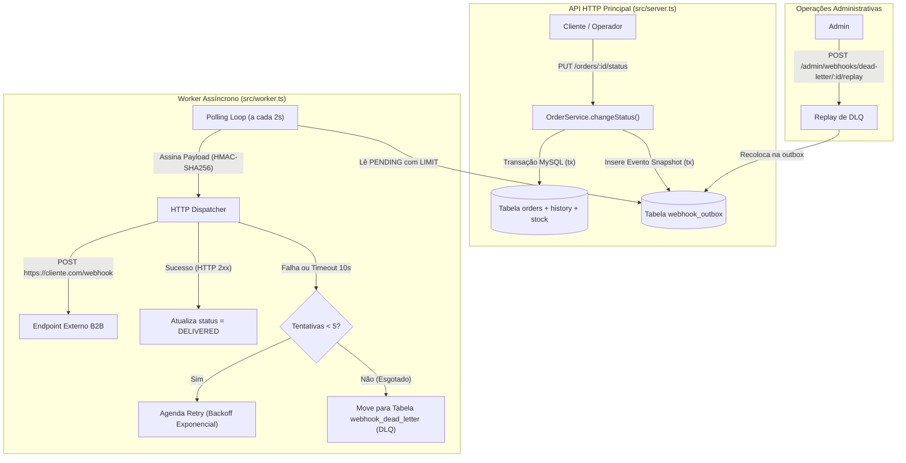

# RFC — Sistema de Webhooks de Notificação de Pedidos

## Metadados
- **Título:** Proposta Técnica para o Sistema de Webhooks Outbound de Notificação de Pedidos
- **Autor:** Time de Engenharia do OMS
- **Status:** Proposto / Em Revisão
- **Data de Submissão:** Novembro de 2026
- **Revisores:**
  - Larissa (Tech Lead)
  - Marcos (Product Manager)
  - Bruno (Engenheiro Pleno — Time de Pedidos)
  - Diego (Engenheiro Sênior — Time de Plataforma)
  - Sofia (Engenheira de Segurança)

---

## 1. Resumo Executivo (TL;DR)
Propõe-se a construção de um subsistema assíncrono de **Webhooks Outbound** no Order Management System (OMS) para notificar sistemas externos de clientes B2B em tempo real (< 10 segundos) sempre que houver alteração de status em seus pedidos. 

A arquitetura adota o **Padrão Transactional Outbox** no banco de dados MySQL existente, desacoplando a transação de negócio de pedidos do envio de rede. Um **Worker em processo separado** fará o despacho HTTP via polling de 2 segundos, com **autenticação via HMAC-SHA256**, garantia de entrega **at-least-once**, resiliência por **backoff exponencial em 5 tentativas** e desvio de mensagens com falha permanente para uma **Dead Letter Queue (DLQ)** para auditoria e reprocessamento manual via endpoint administrativo.

---

## 2. Contexto e Problema
Três clientes corporativos estratégicos da plataforma — **Atlas Comercial**, **MaxDistribuição** e **Nova Cargo** — solicitaram formalmente a capacidade de receber atualizações de pedidos orientadas a eventos.

Atualmente, esses clientes realizam varreduras contínuas (*polling*) consultando o endpoint `GET /orders` repetidamente para detectar alterações de status. Esse modelo acarreta:
1. **Ineficiência de Rede e Servidor:** Alto consumo de CPU, conexões MySQL e largura de banda para responder majoritariamente a consultas sem alterações.
2. **Latência de Integração e Risco de Churn:** A sincronização lenta gerou gargalos operacionais nos centros de distribuição dos clientes, culminando no ultimato da Atlas Comercial de migração para um concorrente caso a solução não seja implantada até o encerramento do trimestre ([09:00] Marcos).

A meta de negócio é entregar notificações confiáveis em menos de 10 segundos após a mudança de status, com prazo total estimado em 3 sprints de desenvolvimento ([09:02] Marcos, [09:47] Larissa).

---

## 3. Proposta Técnica (Visão Geral da Arquitetura)

A solução é desenhada sobre quatro pilares arquiteturais:

### Componentes Arquiteturais
1. **Produtor Transacional (Outbox):** No momento da alteração de status em `src/modules/orders/order.service.ts`, o evento é gravado na tabela `webhook_outbox` como parte indissociável da mesma transação do Prisma, armazenando um snapshot imutável do pedido no momento exato da transição.
2. **Consumidor em Processo Desacoplado (Worker):** Processo Node.js independente (`src/worker.ts`) que roda em loop de 2 segundos, mantendo seu próprio pool de conexões e processando eventos em ordem cronológica de criação.
3. **Segurança de Transporte e Assinatura:** Exigência de HTTPS obrigatório, verificação de integridade via header `X-Signature` contendo HMAC-SHA256 calculado com secret exclusiva por endpoint cadastrado, chave rotacionável com janela de transição de 24 horas e cabeçalhos `X-Event-Id` e `X-Timestamp`.
4. **Resiliência e DLQ:** Timeout estrito de 10 segundos por chamada HTTP, política de 5 retries com backoff progressivo cobrindo cerca de 15 horas e isolamento de falhas irrecuperáveis na tabela `webhook_dead_letter`.

---

## 4. Alternativas Consideradas e Trade-offs

Durante a sessão de design técnico, três abordagens alternativas foram avaliadas e descartadas em prol da simplicidade e robustez:

### 4.1. Disparo HTTP Síncrono no `OrderService`
- **Conceito:** O método `changeStatus` realizaria a requisição HTTP diretamente antes do commit da transação.
- **Trade-off de Descarte:** Rejeitado por unanimidade ([09:04] Bruno, [09:06] Diego). Qualquer lentidão de rede do cliente travaria a transação do banco, segurando locks de estoque e impedindo atualizações de outros pedidos. Se o cliente estivesse fora do ar, geraria o dilema inaceitável de fazer rollback de um status de negócio legítimo.

### 4.2. Mensageria Externa / Broker Distribuído (Redis Streams, RabbitMQ ou Kafka)
- **Conceito:** Instanciar um cluster de mensageria para gerenciar filas e tópicos de eventos de webhook.
- **Trade-off de Descarte:** Descartado por overengineering e custo operacional ([09:07] Larissa, Diego). Para o volume atual de pedidos e o tamanho enxuto da equipe de engenharia, gerenciar um cluster Redis ou RabbitMQ adicionaria pontos de falha na infraestrutura sem eliminar o problema de escrita dupla (que ainda exigiria um outbox no banco).

### 4.3. Triggers Nativas do MySQL com Notificação Externa
- **Conceito:** Usar triggers de banco para disparar o worker reativamente.
- **Trade-off de Descarte:** Descartado por limitação da engine do MySQL ([09:09] Diego). O MySQL não possui sistema nativo assíncrono de pub/sub como o PostgreSQL (`LISTEN/NOTIFY`). Acoplar triggers SQL a chamadas de sistema operacional ou arquivos em disco traria altíssima fragilidade e risco de segurança.

---

## 5. Questões em Aberto e Próximos Passos

Os seguintes pontos foram levantados na reunião técnica como relevantes, mas foram deliberadamente deixados em aberto ou adiados para iterações futuras:

1. **Notificação de Falhas por E-mail:** Envio de alertas por e-mail para o cliente corporativo após falhas consecutivas de webhook. *Decisão:* Adiado para a fase subsequente ([09:37] Larissa), mantendo o foco do MVP nos fluxos fundamentais de entrega e DLQ.
2. **Rate Limiting de Saída por Cliente:** Mecanismo de controle de vazão (throttling) caso dezenas de pedidos de um mesmo cliente sofram transição simultânea em lote. *Decisão:* Observar o comportamento em produção durante a fase piloto e implementar controle de concorrência por domínio apenas se houver sobrecarga detectada ([09:39] Diego).
3. **Política de Expurgamento/Arquivamento da Outbox:** Limpeza ou transferência periódica de eventos com status `DELIVERED` após 30 dias para tabelas analíticas frias. *Decisão:* Mapeado como tarefa de manutenção de infraestrutura, fora do escopo desta feature de produto ([09:08] Diego).
4. **Painel Visual / Dashboard de Webhooks:** Interface gráfica no frontend para os clientes visualizarem status de entregas. *Decisão:* Fora de escopo do backend OMS; os clientes integrarão diretamente via endpoints REST da API ([09:40] Larissa).

---

## 6. Impacto e Riscos Arquiteturais

| Risco Identificado | Nível | Mitigação Arquitetural |
| :--- | :---: | :--- |
| **Sobrecarga de I/O por Polling no MySQL** | Médio | Índices compostos cobrindo `(status, created_at)` e paginação estrita com `LIMIT` reduzido. |
| **Vazamento ou Exposição de Chave Secreta** | Alto | Segredos exclusivos por endpoint, suporte a rotação com *grace period* de 24h e redação obrigatória de logs no Pino (`src/shared/logger/index.ts`). |
| **Processamento Duplicado no Cliente** | Médio | Cabeçalho `X-Event-Id` único transmitido em todas as requisições, delegando deduplicação ao cliente sob semântica *at-least-once*. |
| **Deadlock em Transações de Mudança de Status** | Baixo | Inserção simples na outbox com chave gerada em memória (UUID), sem necessidade de locks cruzados no banco. |

---

## 7. Decisões Arquiteturais Relacionadas (ADRs)
Para o detalhamento pontual, motivações técnicas e consequências de cada decisão aprovada nesta proposta, consulte os registros canônicos:

- [ADR-001: Adoção do Padrão Outbox no Banco de Dados MySQL](adrs/ADR-001-outbox-no-mysql.md)
- [ADR-002: Execução de Worker em Processo Separado com Polling a Cada 2 Segundos](adrs/ADR-002-worker-separado-em-polling.md)
- [ADR-003: Política de Retry com Backoff Exponencial e Dead Letter Queue (DLQ)](adrs/ADR-003-retry-backoff-exponencial-e-dlq.md)
- [ADR-004: Autenticação por HMAC-SHA256 com Secret Única por Endpoint e Suporte a Rotação](adrs/ADR-004-autenticacao-hmac-sha256-secret-por-endpoint.md)
- [ADR-005: Garantia de Entrega At-Least-Once com Idempotência via Header X-Event-Id](adrs/ADR-005-garantia-at-least-once-com-x-event-id.md)
- [ADR-006: Reuso dos Padrões Arquiteturais, Estruturais e de Observabilidade Existentes](adrs/ADR-006-reuso-padroes-existentes-do-projeto.md)
