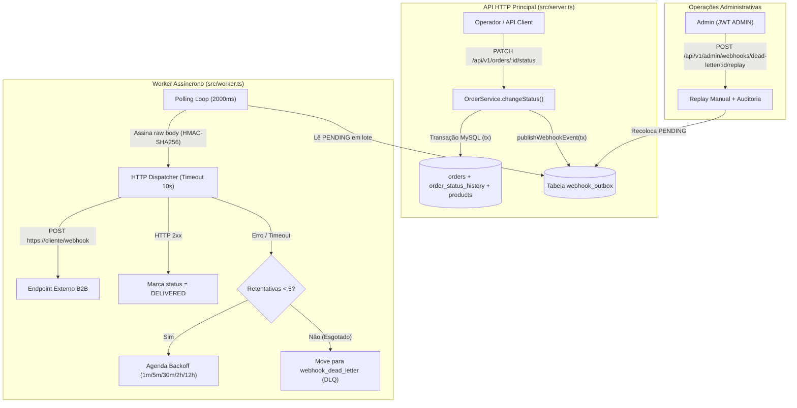

# RFC — Sistema de Webhooks de Notificação de Pedidos

## Metadados
- **Título:** Proposta Técnica para o Sistema de Webhooks Outbound de Notificação de Pedidos
- **Autor:** Time de Engenharia do OMS
- **Status:** Proposto / Em Revisão
- **Data de Submissão:** Novembro de 2026
- **Revisores:**
  - Larissa (Tech Lead)
  - Marcos (Product Manager)
  - Bruno (Engenheiro Pleno — Time de Pedidos)
  - Diego (Engenheiro Sênior — Time de Plataforma)
  - Sofia (Engenheira de Segurança)

---

## 1. Resumo Executivo (TL;DR)
Propõe-se a construção de um subsistema assíncrono de **Webhooks Outbound** no Order Management System (OMS) para notificar sistemas externos de clientes B2B em menos de **10 segundos** sempre que houver alteração de status em seus pedidos (`[09:02] Marcos`).

A arquitetura adota o **Padrão Transactional Outbox** no banco de dados MySQL existente, acoplado à transação de `OrderService.changeStatus`, desacoplando a persistência de negócio do envio HTTP. Um **Worker em processo separado** (`src/worker.ts`) fará o despacho via polling de **2 segundos**, com **autenticação HMAC-SHA256**, garantia de entrega **at-least-once**, resiliência por **backoff exponencial (5 retentativas ao longo de ~15h)** e desvio de falhas permanentes para uma **Dead Letter Queue (DLQ)** com replay manual via endpoint administrativo (`[09:47]–[09:48] Larissa`).

---

## 2. Contexto e Problema
Três clientes corporativos estratégicos da plataforma — **Atlas Comercial**, **MaxDistribuição** e **Nova Cargo** — solicitaram formalmente a capacidade de receber atualizações de pedidos orientadas a eventos (`[09:00] Marcos`).

Atualmente, esses clientes realizam varreduras contínuas (*polling*) consultando o endpoint `GET /api/v1/orders` para detectar alterações de status. Esse modelo acarreta:
1. **Ineficiência de Rede e Banco de Dados:** Alto volume de consultas repetidas sem alterações reais de estado, tornando a integração lenta e custosa para os parceiros (`[09:00] Marcos`).
2. **Risco Comercial Iminente:** A sincronização morosa levou a **Atlas Comercial** a sinalizar risco de migração para um concorrente caso a entrega não ocorra até o fim do trimestre (`[09:00] Marcos`, prazo estimado de **3 sprints** até fim de novembro — `[09:45]–[09:47] Marcos, Larissa`).

---

## 3. Proposta Técnica (Visão Geral da Arquitetura)

A solução estrutura-se sobre quatro pilares arquiteturais sob o prefixo `/api/v1` e módulo `src/modules/webhooks/`:

### Pilares da Arquitetura
1. **Produtor Transacional (Outbox):** Em `src/modules/orders/order.service.ts` (`changeStatus`), a função pura `publishWebhookEvent(tx, order, fromStatus, toStatus)` grava um snapshot JSON imutável em `webhook_outbox` dentro da mesma transação Prisma (`tx`), filtrando previamente apenas endpoints ativos do `customerId` inscritos no status de destino (`[09:34] Bruno`, `[09:41] Bruno, Diego`, `[09:52] Larissa`).
2. **Consumidor Desacoplado (Worker):** Processo Node.js independente (`src/worker.ts`, via `npm run worker`) com seu próprio `PrismaClient` e loop de polling a cada 2 segundos, processando eventos em ordem de `created_at` por `order_id` (`[09:09]–[09:12] Diego`, `[09:30] Bruno`).
3. **Segurança e Entrega:** URLs `https://` obrigatórias, payload máximo de **64 KB** (rejeição com erro se exceder), assinatura `HMAC-SHA256` por endpoint (`X-Signature`), rotação de secret com carência de **24 horas**, `X-Timestamp`, `X-Webhook-Id` e semântica *at-least-once* com deduplicação por `X-Event-Id` (`[09:20]–[09:25] Sofia, Diego`, `[09:44] Diego, Sofia`).
4. **Reuso de Padrões do Projeto:** Novo domínio `src/modules/webhooks/` reutilizando `AppError` (códigos `WEBHOOK_*`), middleware de erros (`src/middlewares/error.middleware.ts`), Zod (`validate.middleware.ts`), RBAC `requireRole('ADMIN')` (`auth.middleware.ts`) e Pino Logger (`src/shared/logger/index.ts`, estendendo `redactPaths` e propagando `correlation_id`) (`[09:27]–[09:30] Bruno, Larissa`).

---

## 4. Alternativas Consideradas e Trade-offs

Durante a reunião técnica, quatro abordagens alternativas foram debatidas e descartadas em favor de simplicidade operacional e consistência transacional:

### 4.1. Disparo HTTP Síncrono Dentro do `OrderService`
- **Conceito:** Executar a chamada HTTP diretamente dentro de `changeStatus` antes de responder ao cliente.
- **Trade-off de Descarte:** Rejeitado por unanimidade (`[09:04] Bruno`, `[09:06] Diego`). Qualquer lentidão ou indisponibilidade de um parceiro bloquearia locks de transação no MySQL (que já atualiza pedido, histórico e estoque), criando o dilema impossível entre dar rollback em uma transição válida de negócio ou perder notificações.

### 4.2. Broker Externo de Mensageria (Redis Streams / RabbitMQ / Kafka)
- **Conceito:** Introduzir infraestrutura de fila externa para publicar e consumir eventos de webhook.
- **Trade-off de Descarte:** Descartado por overengineering (`[09:07] Larissa, Diego`). A equipe de engenharia é pequena e não possui necessidade de escalar mais um serviço de infraestrutura no MVP; além disso, um broker externo não eliminaria o problema de escrita dupla sem uma tabela outbox no banco.

### 4.3. Triggers Nativas no MySQL para Acionamento Reativo
- **Conceito:** Utilizar triggers de banco para disparar diretamente um worker sem polling.
- **Trade-off de Descarte:** Rejeitado por limitação do SGBD (`[09:09] Diego`). O MySQL não dispõe de mecanismo assíncrono nativo equivalente ao `LISTEN/NOTIFY` do PostgreSQL; acoplar triggers SQL a chamadas externas ou arquivos em disco introduziria grande fragilidade operacional.

### 4.4. Garantia Exactly-Once e Secret Global Única
- **Conceito:** Tentar entregar eventos exatamente uma vez ou assinar todos os clientes com uma única chave secreta compartilhada.
- **Trade-off de Descarte:** *Exactly-once* sobre HTTP B2B foi descartado pela alta complexidade de consenso distribuído bilateral (Stripe/GitHub adotam *at-least-once* + `X-Event-Id` — `[09:25] Diego`). A chave global foi vetada pela Segurança porque o vazamento em um cliente comprometeria toda a plataforma (`[09:21] Sofia`).

---

## 5. Questões em Aberto e Próximos Passos

Os seguintes pontos foram deliberadamente deixados em aberto ou postecipados para avaliação futura:

1. **Rate Limiting Outbound por Cliente (`[09:38]–[09:39] Diego, Larissa`):** Caso um cliente tenha dezenas de pedidos transicionando simultaneamente (ex.: 50 pedidos em 1 minuto), não há limite de taxa de saída no MVP; decidiu-se observar o comportamento em produção antes de implementar throttling por domínio.
2. **Fallback por E-mail em Falhas Consecutivas (`[09:37] Larissa, Marcos`):** Notificar o cliente por e-mail caso seu webhook falhe seguidamente (ex.: 3 vezes) ficou adiado para uma segunda fase, após medição do impacto operacional.
3. **Política de Arquivamento / Expurgo da Outbox (`[09:08] Diego`):** Limpeza ou arquivamento de linhas `DELIVERED` com mais de 30 dias ficou mapeada fora do escopo desta feature.
4. **Escala Horizontal Multi-Worker e Ordenação (`[09:12]–[09:13] Diego, Larissa`):** No MVP haverá apenas 1 worker garantindo ordenação por `order_id`; caso seja necessário escalar para múltiplos workers no futuro, será preciso decidir entre particionamento por `order_id` ou locks pessimistas.

---

## 6. Impacto e Riscos Arquiteturais

| Risco Arquitetural | Nível | Estratégia de Mitigação |
| :--- | :---: | :--- |
| **Polling contínuo no MySQL a cada 2s** | Médio | Índice composto `(status, next_retry_at)` e leitura em lote limitado (`LIMIT`), mantendo query de baixo custo (`[09:08] Diego`). |
| **Vazamento de segredos HMAC** | Alto | Secret exclusiva por endpoint, rotação com *grace period* de 24h e extensão do `redactPaths` no logger Pino existente (`[09:21]–[09:22] Sofia`). |
| **Entrega duplicada em oscilações de rede** | Médio | Garantia *at-least-once* com `X-Event-Id` UUID imutável em todas as tentativas e documentação de idempotência para os parceiros (`[09:25]–[09:26] Diego, Marcos`). |
| **Bloqueio por endpoints lentos ou fora do ar** | Médio | Execução isolada em `src/worker.ts`, timeout estrito de 10s, backoff exponencial cobrindo ~15h e isolamento final na `webhook_dead_letter` (`[09:17]–[09:18] Diego`, `[09:42] Sofia`). |

---

## 7. Decisões Arquiteturais Relacionadas (ADRs)
O detalhamento de contexto, alternativas e consequências de cada decisão arquitetural desta proposta encontra-se registrado em:

- [ADR-001: Adoção do Padrão Outbox no Banco de Dados MySQL](adrs/ADR-001-outbox-no-mysql.md)
- [ADR-002: Execução de Worker em Processo Separado com Polling a Cada 2 Segundos](adrs/ADR-002-worker-separado-em-polling.md)
- [ADR-003: Política de Retry com Backoff Exponencial e Dead Letter Queue (DLQ)](adrs/ADR-003-retry-backoff-exponencial-e-dlq.md)
- [ADR-004: Autenticação por HMAC-SHA256 com Secret Única por Endpoint e Suporte a Rotação](adrs/ADR-004-autenticacao-hmac-sha256-secret-por-endpoint.md)
- [ADR-005: Garantia de Entrega At-Least-Once com Idempotência via Header X-Event-Id](adrs/ADR-005-garantia-at-least-once-com-x-event-id.md)
- [ADR-006: Reuso dos Padrões Arquiteturais, Estruturais e de Observabilidade Existentes](adrs/ADR-006-reuso-padroes-existentes-do-projeto.md)
